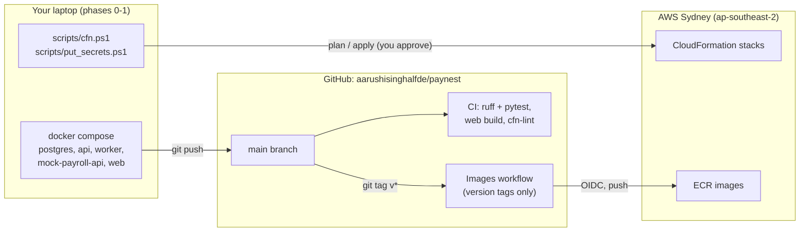
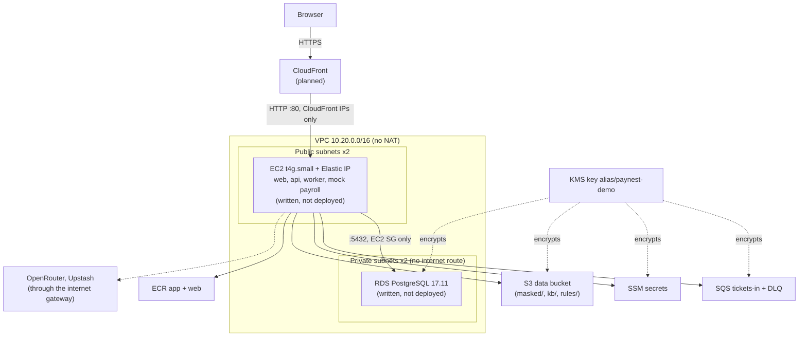
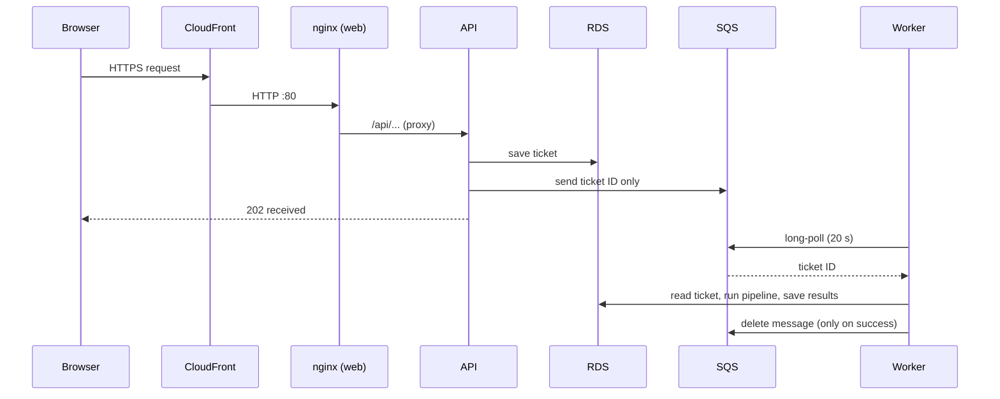
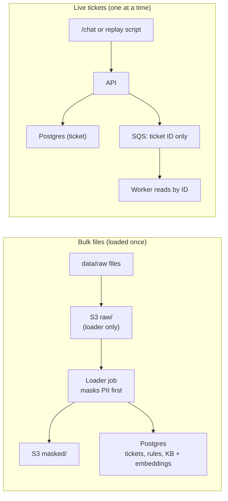
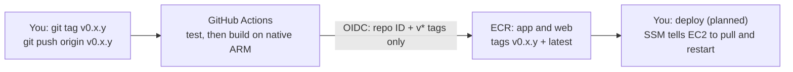

# Paynest architecture

Status as of **20 Nov 2026**: phase 0 and phase 1 done; phase 2 (AWS foundation) in
progress. This file describes what is built, what is planned, and why. Diagrams are
Mermaid and render on GitHub.

Paynest (Payce Support Assist) is a support-ticket assistant for a payroll provider with
India and UAE tenants. Every ticket is PII-masked first, classified and routed by rules,
answered from approved sources, checked by an output guard, and sent to a human reviewer
when the answer is statutory.

---

## 1. Where everything lives

| Place | What it holds |
| --- | --- |
| Laptop | The full app in Docker Compose for development; the scripts that deploy AWS stacks and secrets. |
| GitHub | Source code, CI checks on every push, and the release workflow that builds images. |
| AWS Sydney | The demo environment, defined entirely in CloudFormation. |

**Rule:** nothing reaches AWS without an explicit human action: `cfn.ps1 apply` after a
reviewed change set, `put_secrets.ps1`, or pushing a version tag.

---

## 2. The application (phase 1, runs locally today)

| Service | Code | Role |
| --- | --- | --- |
| `api` | `api/main.py` (FastAPI) | `/health` (region), `/ready` (checks Postgres, Redis, queue; 503 if any fails). Runs `scripts/migrate.py` before starting. |
| `worker` | `worker/main.py` | Long-polls SQS every 20 s, processes a message, deletes it only on success, retries queue outages with backoff. LangGraph arrives in phase 5. |
| `postgres` | `pgvector/pgvector:pg17` | Database with `vector` (meaning search) and `pg_trgm` (fuzzy/code matching). Plain SQL migrations in `db/migrations/`. |
| `mock-payroll-api` | `mock-payroll-api/app.py` | Stand-in payroll system; the agent will call it as a tool. |
| `web` | `web/` (React + Vite, nginx) | Dashboard shell; nginx proxies `/api/` to the API. |

External services used locally: **Upstash Redis** (cache) and the **dev SQS queue** in
Sydney (`paynest-dev-tickets-in` + DLQ), or **ElasticMQ** offline
(`docker compose --profile local-queue`). Gate: `scripts/check_phase1.py`, 6/6 in both
queue modes.

---

## 3. AWS architecture (target for phase 2)

### Stacks (`infra/cfn/`, deployed with `scripts\cfn.ps1`)

| # | Stack | Resources | Status |
| --- | --- | --- | --- |
| 1 | `network` | VPC `10.20.0.0/16`, 2 public + 2 private subnets in 2 AZs, internet gateway, route tables. No NAT. | Deployed |
| 2 | `security` | EC2 security group (port 80 from the CloudFront prefix list only, no SSH); RDS security group (5432 from the EC2 group only, no egress); KMS key `alias/paynest-demo` with rotation. | Deployed |
| 3 | `data` | S3 bucket `paynest-demo-data-<account>` (KMS, versioned, private, HTTPS-only, retained on delete); SQS `paynest-demo-tickets-in` + DLQ (KMS, 3 tries); ECR `paynest-demo/app`, `paynest-demo/web` (scan on push, keep 5). | Deployed |
| 4 | `iam` | EC2 role + instance profile (least privilege); GitHub OIDC provider; GitHub deploy role (push to ECR only). | Deployed |
| 5 | `rds` | PostgreSQL 17.11 `db.t4g.micro`, private, KMS, password managed by AWS in Secrets Manager, 1-day backups, final snapshot on delete. | Written |
| 6 | `ec2` | t4g.small (AL2023 arm64), Elastic IP, encrypted disk, IMDSv2; boot script installs Docker and a `paynest` systemd service; grants read access to the DB secret. | Written |
| 7 | `cloudfront` | Public HTTPS address in front of the EC2. | Planned |

Every template has a `Rules` check: `params/india.json` and `params/uae.json`
(`Deployable=false`) can be validated but never deployed. Stacks share values through
exports (`paynest-demo-VpcId`, ...), so CloudFormation refuses to delete a stack that
another still uses; delete newest first.

### How the EC2 starts the app

1. Boot script installs Docker and Docker Compose, writes non-secret settings to
   `/opt/paynest/settings`, the production compose file, and the `paynest` systemd unit.
2. On every start, `paynest.service`:
   - reads `/paynest/demo/*` from SSM and the DB password from Secrets Manager into
     `/run/paynest/app.env` (memory only, wiped at every stop);
   - logs in to ECR, pulls `app:latest` and `web:latest`;
   - runs `docker compose up -d` (api runs migrations first; web listens on port 80).
3. If the images are not in ECR yet, it retries every minute.

---

## 4. Request flow (once EC2 and CloudFront are live)

After 3 failed attempts a message moves to the DLQ, so one bad ticket never blocks the queue.

---

## 5. Data flow

- **Files never go through SQS.** SQS carries only a ticket ID (claim-check pattern), so
  wiping the queue loses no data and messages stay tiny.
- **Masking happens before anything else** reads ticket text. The EC2 role cannot read
  `raw/`.
- **Demo traffic is replayed through the API**, so the demo exercises the real path.

---

## 6. Release flow (images)

- Ordinary pushes run CI only. Images are built **only** for version tags (or a manual run
  from `main`).
- The GitHub deploy role trusts GitHub's immutable subject
  `repo:aarushisinghalfde@319837126/paynest@1464089610:ref:refs/tags/v*` (or `refs/heads/main`),
  so a renamed or re-created repository cannot assume it. No AWS keys are stored in GitHub.
- Images are arm64 to match the Graviton (t4g) EC2. ECR keeps the last 5 per repository.

---

## 7. Security controls

| Control | Where |
| --- | --- |
| No SSH; admin access via SSM Session Manager | `security`, `iam` |
| EC2 reachable only from CloudFront on port 80 | `security` |
| RDS private, reachable only from the EC2 security group | `network`, `security`, `rds` |
| One KMS key for S3, SQS, SSM, RDS and the EC2 disk | `security` |
| Secrets in SSM / Secrets Manager, loaded into memory at start; nothing in git or on disk | `put_secrets.ps1`, `ec2` |
| Least-privilege roles (one queue, one key, own secrets, masked S3 prefixes, ECR pull) | `iam`, `ec2` |
| CI and release separated; release needs a version tag | `.github/workflows/` |
| Placeholder regions cannot be deployed | `Rules` in every template |
| S3 data retained and RDS snapshotted if a stack is deleted | `data`, `rds` |

---

## 8. Cost (demo, Sydney, approximate)

| Item | Running | Stopped |
| --- | --- | --- |
| Foundation (VPC, SGs, S3, SQS, ECR, IAM, SSM) | cents per month | cents per month |
| KMS key | about USD 1 per month | same |
| RDS `db.t4g.micro` + 20 GB | about USD 0.70 per day | storage only (about USD 0.09 per day) |
| EC2 `t4g.small` + 20 GB disk | about USD 0.57 per day | disk only (about USD 0.06 per day) |
| Elastic IP | about USD 0.12 per day | same (charged while stopped) |
| CloudFront, GitHub Actions | free at demo volume | - |

EC2 and RDS are started only for work sessions and demos (start/stop scripts planned).

---

## 9. Key decisions

| Date | Decision | Why |
| --- | --- | --- |
| 19 Nov | Upstash Redis instead of a Redis container; real SQS in Sydney with optional ElasticMQ | Same services locally and in AWS; work offline when needed. |
| 20 Nov | **CloudFormation** instead of Terraform | AWS keeps the state, automatic rollback, team familiarity; everything deployed is AWS. |
| 20 Nov | **Hosting option B: CloudFront -> EC2** (not Vercel) | Free HTTPS without a domain, no CORS, everything in AWS. |
| 20 Nov | **Custom VPC, no NAT** | RDS in private subnets; nothing private needs outbound internet. |
| 20 Nov | **No SSH**, SSM Session Manager only | No open admin port, no keys to manage. |
| 20 Nov | **Files -> S3 -> loader -> Postgres; SQS carries IDs only** | Replayable, auditable, PII contained. |
| 20 Nov | **Images built by GitHub Actions on native ARM, on version tags** | CodeBuild was blocked by a new-account limit; GitHub ARM runners are native and free for public repos. |
| 20 Nov | **AgentCore** Gateway + Policy + Observability in phases 5 to 7 | Managed tools and deterministic tool-call rules (tenant isolation). Runtime (zip deployment) under consideration for the agent. |

---

## 10. Operating it

| Task | Command (from the repo root, PowerShell) |
| --- | --- |
| Check a template | `.\scripts\cfn.ps1 validate <stack>` |
| Preview changes (no effect) | `.\scripts\cfn.ps1 plan <stack>` |
| Apply the reviewed change set | `.\scripts\cfn.ps1 apply <stack>` |
| Show outputs / failures | `.\scripts\cfn.ps1 output <stack>`, `.\scripts\cfn.ps1 events <stack>` |
| Delete a stack (asks for its name) | `.\scripts\cfn.ps1 delete <stack>` |
| Store secrets from `.env` in SSM | `.\scripts\put_secrets.ps1` |
| Release images | `git tag v0.x.y` then `git push origin v0.x.y` |
| Run locally | `docker compose up -d --build --wait` (see README) |

Deploy order: `network`, `security`, `data`, `iam`, `rds`, `ec2`, `cloudfront`. Delete in reverse.

---

## 11. What is next

1. First release `v0.1.0` (images into ECR).
2. Deploy `rds`, then `ec2` (same session; hourly billing starts).
3. Write and deploy `cloudfront`; start/stop scripts; `scripts/check_phase2.py` gate.
4. Phase 3 onwards: data loader (S3 -> masking -> Postgres), then the LangGraph agent and
   AgentCore (phase 5).

Open items: free disk space on the laptop; Bedrock support case; `OPENROUTER_API_KEY` into
SSM before phase 6; phase 3/4 data files still to be provided.
