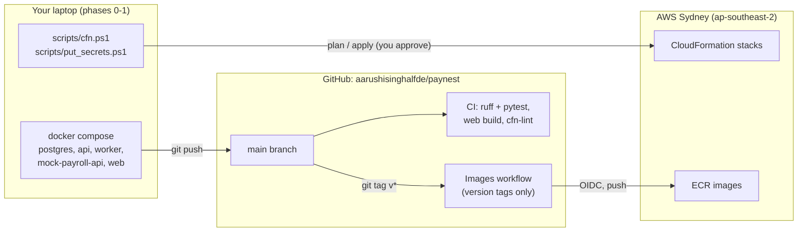
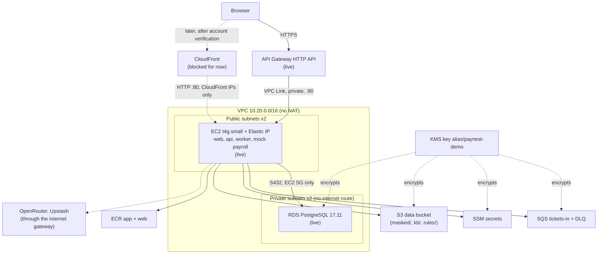
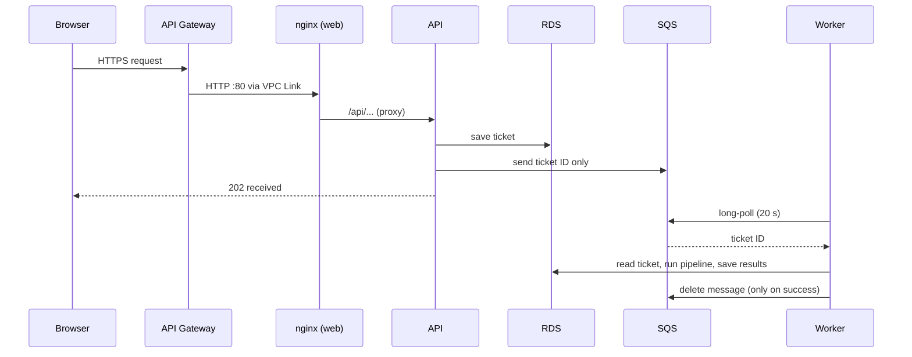
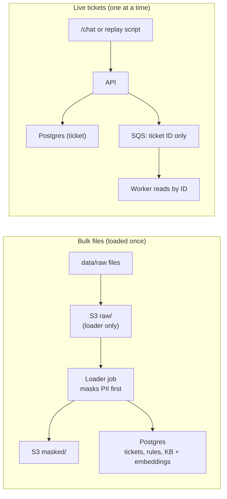
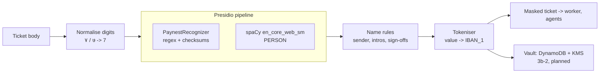
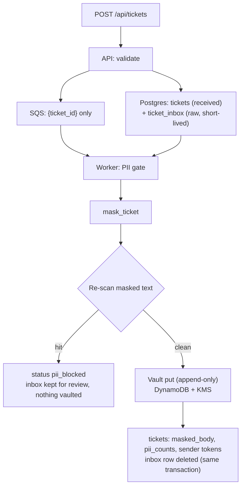
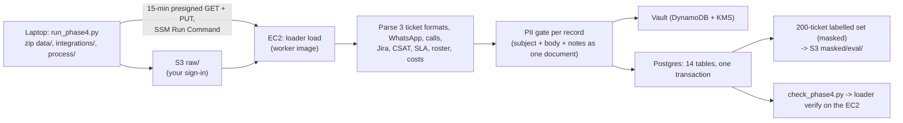
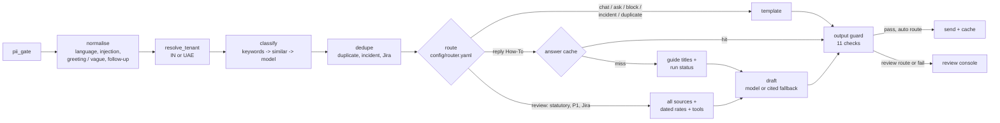
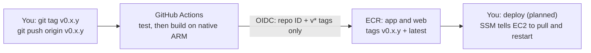

# Paynest architecture

Status as of **20 Nov 2026, night**: phases 0-7 **live in Sydney** at
https://whps24ardd.execute-api.ap-southeast-2.amazonaws.com (gates: phase 3 12/12, phase 4 all
pass, phase 5 4/4); phases 8-9 and the How-To conversation flow in code and released as
v0.4.2. This file describes what is built, what is planned, and why. Diagrams are Mermaid and
render on GitHub. Companion docs: [PRD](paynest_PRD.md), [discovery note](paynest_Discovery_Note.md),
[SPIN sheet](paynest_SPIN_Sheet.md), [solution approach](solution_approach.md), [LLD](lld.md),
[build note](build_note.md), [presentation](Payce_Support_Assist_build_review.pptx).

Paynest (Payce Support Assist) is a support-ticket assistant for a payroll provider with
India and UAE tenants. Every ticket is PII-masked first, classified and routed by rules,
answered from approved sources, checked by an output guard, and sent to a human reviewer
when the answer is statutory.

---

## 1. Where everything lives

| Place | What it holds |
| --- | --- |
| Laptop | The full app in Docker Compose for development; the scripts that deploy AWS stacks and secrets. |
| GitHub | Source code, CI checks on every push, and the release workflow that builds images. |
| AWS Sydney | The demo environment, defined entirely in CloudFormation. |

**Rule:** nothing reaches AWS without an explicit human action: `cfn.ps1 apply` after a
reviewed change set, `put_secrets.ps1`, or pushing a version tag.

---

## 2. The application (phase 1, runs locally today)

| Service | Code | Role |
| --- | --- | --- |
| `api` | `api/main.py` (FastAPI) | `/health` (region), `/ready` (checks Postgres, Redis, queue; 503 if any fails). Runs `scripts/migrate.py` before starting. |
| `worker` | `worker/main.py` | Long-polls SQS every 20 s, processes a message, deletes it only on success, retries queue outages with backoff. LangGraph arrives in phase 5. |
| `postgres` | `pgvector/pgvector:pg17` | Database with `vector` (meaning search) and `pg_trgm` (fuzzy/code matching). Plain SQL migrations in `db/migrations/`. |
| `mock-payroll-api` | `mock-payroll-api/app.py` | Stand-in payroll system; the agent will call it as a tool. |
| `web` | `web/` (React + Vite, nginx) | Dashboard shell; nginx proxies `/api/` to the API. |

External services used locally: **Upstash Redis** (cache) and the **dev SQS queue** in
Sydney (`paynest-dev-tickets-in` + DLQ), or **ElasticMQ** offline
(`docker compose --profile local-queue`). Gate: `scripts/check_phase1.py`, 6/6 in both
queue modes.

---

## 3. AWS architecture (live in Sydney)

### Stacks (`infra/cfn/`, deployed with `scripts\cfn.ps1`)

| # | Stack | Resources | Status |
| --- | --- | --- | --- |
| 1 | `network` | VPC `10.20.0.0/16`, 2 public + 2 private subnets in 2 AZs, internet gateway, route tables. No NAT. | Deployed |
| 2 | `security` | EC2 security group (port 80 from the CloudFront prefix list only, no SSH); RDS security group (5432 from the EC2 group only, no egress); KMS key `alias/paynest-demo` with rotation. | Deployed |
| 3 | `data` | S3 bucket `paynest-demo-data-<account>` (KMS, versioned, private, HTTPS-only, retained on delete); SQS `paynest-demo-tickets-in` + DLQ (KMS, 3 tries); ECR `paynest-demo/app`, `paynest-demo/web` (scan on push, keep 5). | Deployed |
| 4 | `iam` | EC2 role + instance profile (least privilege); GitHub OIDC provider; GitHub deploy role (push to ECR only). | Deployed |
| 5 | `rds` | PostgreSQL 17.11 `db.t4g.micro`, private, KMS, password managed by AWS in Secrets Manager, 1-day backups, final snapshot on delete. | Deployed |
| 6 | `ec2` | t4g.small (AL2023 arm64), Elastic IP, encrypted disk, IMDSv2; boot script installs Docker and a `paynest` systemd service; grants read access to the DB secret. | Deployed |
| 7a | `apigw` | Public HTTPS URL via an API Gateway HTTP API; a VPC Link (private subnets) plus Cloud Map reaches the EC2 private IP on port 80; rate limit 20 req/s. Limits: 30 s per request, no WebSockets. | **Deployed** (live URL) |
| 7b | `cloudfront` | Distribution `https://<id>.cloudfront.net` in front of the EC2 (WebSockets, edge caching of `/assets/*`). | Written; **blocked** until AWS verifies the account |
| 8 | `vault` | PII vault: DynamoDB `paynest-demo-pii-vault` (on-demand, TTL, retained), vault KMS key `alias/paynest-demo-vault` (admin cannot use it; EC2 Encrypt only, Lambda Decrypt only, both bound to the `{ticket_id, token, tenant_id}` context), `paynest-demo-vault-reveal` Lambda (outside the VPC, audited, 90-day log), EC2 policy (PutItem + Encrypt; explicit deny on read and decrypt), SSM worker settings (`VAULT_*`, `PII_NER=required`). | Written (3b-2), awaiting approval |
| 9 | `observability` | Log group `/paynest/demo/app` (14 days), EC2 permission to write it, metric filters on the JSON events (PiiBlocked, TicketsMasked, MaskLatencyMs, MaskedWithoutNer, WorkerFailures), 4 alarms (pii-blocked, pii-ner-off, worker-failures, tickets-dlq-not-empty), optional email via SNS. | Written (3b-2), awaiting approval |

Every template has a `Rules` check: `params/india.json` and `params/uae.json`
(`Deployable=false`) can be validated but never deployed. Stacks share values through
exports (`paynest-demo-VpcId`, ...), so CloudFormation refuses to delete a stack that
another still uses; delete newest first.

### How the EC2 starts the app

1. Boot script (runs at **every** boot since 3b-2, via cloud-init `scripts-user, always`;
   it is idempotent) sets Docker's log driver to CloudWatch (`awslogs`, non-blocking),
   installs Docker and Docker Compose, writes non-secret settings to
   `/opt/paynest/settings`, the production compose file, and the `paynest` systemd unit,
   then restarts the service. Changing the user data makes CloudFormation stop and start
   the instance (same private IP and Elastic IP), which applies the change.
2. On every start, `paynest.service`:
   - reads `/paynest/demo/*` from SSM and the DB password from Secrets Manager into
     `/run/paynest/app.env` (memory only, wiped at every stop);
   - logs in to ECR, pulls `app:latest` and `web:latest`;
   - runs `docker compose up -d` (api runs migrations first; web listens on port 80).
3. If the images are not in ECR yet, it retries every minute.

---

## 4. Request flow (live)

After 3 failed attempts a message moves to the DLQ, so one bad ticket never blocks the queue.

---

## 5. Data flow

- **Files never go through SQS.** SQS carries only a ticket ID (claim-check pattern), so
  wiping the queue loses no data and messages stay tiny.
- **Masking happens before anything else** reads ticket text. The EC2 role cannot read
  `raw/`.
- **Demo traffic is replayed through the API**, so the demo exercises the real path.

### PII gate (phase 3, `pii/`)

- **Our recognisers are the gate.** Aadhaar (Verhoeff), Emirates ID (Luhn), IBAN (mod-97),
  PAN, IFSC, UAN, phones, emails and unknown long numbers. They give the same result with
  or without Presidio, and the 60-ticket leak test (English, Hinglish, Hindi, Arabic) must
  show 0 raw values.
- **Mid-sentence names** are found by a capitalised-name rule (two or more capitalised words
  that are not common or payroll words, e.g. "Ananya Iyer") and by spaCy (`en_core_web_sm`)
  through Presidio. The first CI run showed spaCy alone missed 3 of 12 Indian names and
  tagged "Email" as a person, so the rule is part of the gate; 12 extra seeded tickets
  test it.
- **Single first names** ("Gaurav will send it", "Kal Zubair ne bola", "مع سلطان") are found
  by context cues (ask/with/said/'s, Hinglish ne/ka/ko/ji) and a list of common Indian and
  Arab first names in Latin, Devanagari and Arabic script (`pii/names.py`). Names that are
  also everyday words (निधि as in भविष्य निधि, مبارك, عمر "age") are excluded, and a
  precision test checks that ordinary sentences in all four languages come back unchanged.
- **Same value, same token** within a ticket (`<NAME_1>` everywhere), so agents can still
  follow the conversation.
- `PII_NER=auto|required|off` controls the Presidio layer (`required` in the worker image).
- **Known limit, and the standard fix:** checksum rules for IDs are industry practice; the
  first-name list and cues are a stop-gap because `en_core_web_sm` is English-only and weak
  on Indian names. Planned 3c: a multilingual transformer NER in Presidio as the main name
  detector (list kept as backup), chosen by measured recall vs RAM. Amazon Comprehend PII
  is English/Spanish only, so it cannot cover Hindi or Arabic.

### Ticket intake and the gate (phase 3b, `api/`, `intake/`, `worker/`)

- **Raw text lives in one place, briefly.** `ticket_inbox` holds the body and sender
  fields until the worker masks them; the same transaction that saves `masked_body`
  deletes the inbox row. `GET /tickets/{id}` never returns raw text and shows the body
  only once the gate has passed it.
- **Re-scan before release.** The masked text is checked three ways: no vaulted value
  survives (whole-word, so `علي` inside `عليه` is not a hit), the sender's email or phone
  is not left in the text, and a second masking pass finds nothing. Any hit quarantines
  the ticket as `pii_blocked` with reasons that name kinds only (`second_pass:PHONE`).
- **Sender tokens.** `HMAC-SHA256(PII_HMAC_KEY, tenant | kind | normalised value)`: the
  same sender in one tenant always gets the same `em_...` / `ph_...` token, different
  tenants get different tokens, and the key lives in SSM. The raw sender fields go to the
  vault as `<SENDER_NAME>`, `<SENDER_EMAIL>`, `<SENDER_PHONE>` for replies.
- **Vault (decided 20 Nov: DynamoDB, not Postgres).** One item per value (`ticket_id`,
  `token`), each encrypted with the vault KMS key and the encryption context
  `{ticket_id, token, tenant_id}`, so KMS itself refuses a reveal for the wrong ticket.
  Writes are conditional (append-only). TTL removes values after `VAULT_TTL_DAYS` (30).
  EC2 role: `kms:Encrypt` + `dynamodb:PutItem` only. The `vault-reveal` Lambda (outside the
  VPC, so no KMS endpoint is needed) is the only role with `GetItem` and `kms:Decrypt`.
- **Retries are safe.** Values are vaulted before the masked row is saved; if the vault
  write fails the inbox row stays and SQS redelivers. A redelivered message for a masked
  ticket is skipped.
- **Logs are JSON lines with ids, kinds, counts and timings, never values**
  (`shared/logs.py`). Exceptions are logged as type + file:line only, because exception
  messages can quote data (a Postgres error can include the failing row). Events:
  `ticket_received`, `ticket_masked`, `pii_blocked`, `ticket_skipped`, `message_failed`.
- **Evaluation:** `python scripts/eval_pii.py` reports recall per type and language,
  over-masking (30 clean sentences in `tests/fixtures/pii_clean.json` plus unlabelled
  spans) and latency; `--record` appends rows to `results/gates.csv`. On the synthetic
  seed (rules only): 100% of 408 values, 0/30 clean sentences changed, p50 0.6 ms. This
  proves the plumbing; real recall needs the phase 4 data.

### Data load (phase 4, `loader/`)

- **The raw data never leaves the EC2 and S3.** The EC2 role still has no access to
  `raw/`: your laptop script uploads the zip with your sign-in and hands the EC2 a 15-minute
  presigned URL. Only operational files are loaded (`data/`, `integrations/`, `process/`);
  interview transcripts, emails and the org chart are discovery material for people.
- **Masking by format (phase 4 decision).** The real export's IDs fail their checksums on
  purpose (Aadhaar `0000...`, IBAN `AE00...`, PAN `ABCDE...`): the phase 3 gate leaked all 38
  PANs. Any value shaped like an ID is now masked; the checksum or a nearby keyword only picks
  the label. Real data also exposed two name false positives (a cue crossing a line break;
  Hindi "कर्मचारी कैसे जोड़ें"), fixed and regression-tested. Result: 0 leaks, 103 tickets with PII.
- **Timestamps to UTC, by evidence:** naive values are IST in all three ticket systems
  (widget +5:30 from its epoch history, 483/483; partner +5:30 from `opened_on`, 219/219; email
  naive events in order only when read as IST, 185/185). Call and CSAT times assumed IST.
- **Duplicates:** the 14 repeated rows are dropped (1,367 -> 1,353 unique); the 26 resubmits
  ("duplicate of PN-...") stay as tickets for phase 7. 65 partner tickets carry only the end
  customer's name; the loader resolves the tenant by name and records `tenant_resolved_by`.
- **Labels:** the export's top-level category is the *final* label; the customer's pick is on
  the `created` event. 201 of 1,327 picks were wrong, 111 tickets moved more than once.
- **Knowledge with dates:** 24 KB titles, the 4 old excerpts (closed with `effective_to`,
  `superseded_by` the rule), 4 rule chunks, 18 process-doc sections. `get_rate(region, topic,
  as_of)` returns the old value before a rule's date and the new one from it.
- **Data minimisation:** agent names and SLA approvers' names are not loaded.
- **Labelled set:** 200 masked tickets stratified by team (9) and language (4), saved to
  `s3://.../masked/eval/` and `evals/local/` (git-ignored: masked client data stays out of the
  public repo). Next: an independent relabel and a human check of every disagreement.
- **Routing:** `config/routing.yaml`. Every tenant has a home region (`ap-south-1` or
  `me-central-1`); the demo table sends all to Sydney, the production table to the home
  region. A load refuses to run in a region its table sends no tenant to.

### The agent (phases 5-9, `agent/`, `worker/`)

- **Checkpointed graph:** LangGraph + `PostgresSaver` (thread id = ticket id). A crashed worker
  resumes at the failed node; `sent_replies` is unique on (ticket, version), so nothing is sent twice.
- **Classifier (phase 6):** keywords in EN/Hinglish/HI/AR, then similar past tickets (character
  TF-IDF kNN on the loaded, masked tickets), then a model only on disagreement (OpenRouter,
  cost ledger, USD 0.50/day cap). How-to phrasing with no problem signal goes to How-To.
- **Dedupe and routing (phase 7):** duplicate = explicit reference, or resubmit marker and
  similarity >= 0.8; incident = 5 similar in 3 h; Jira by word containment. YAML router, first
  match wins, rule id and reason stored and shown. Injection phrasing in 4 languages is blocked.
- **Answering (phase 8):** question date from the text (ISO date or month) else the ticket date;
  retrieval filtered by tenant region and validity on that date (BM25 + character trigrams,
  Arabic/Hindi glossary). Tools: `get_rate` by date, `get_run_status` (429-aware),
  `get_tenant_profile`, `get_incident`. Auto-sent replies cite guide titles and run status only;
  statutory figures only on the review route.
- **How-To conversation:** each chat page has a `conversation_id` (migration 006); a short
  follow-up or the answer to a clarifying question is read with the earlier turn. How-To answers
  come from the **answer cache** first (Redis, matched by meaning, keyed by region, language and
  KB version), then from the guides; a guarded answer is cached for the next asker.
- **Output guard (phase 9):** empty/too long, PII, unknown token, bad citation, ungrounded number,
  uncited answer, wrong region, superseded source, instruction leak, promise, wrong language.
  Planted set: 20/20 bad caught, 10/10 good passed. A failed draft goes to review, never out.
- **Customer view (phase 10 part):** replies are stored masked; the API removes tokens and
  citation ids before the customer sees them. Real values would come only through the audited
  reveal Lambda in a production send adapter.
- **Tracing (phase 11 part):** every node logs `node_done` with its time; OpenTelemetry spans
  when `OTEL_EXPORTER_OTLP_ENDPOINT` is set.

---

## 6. Release flow (images)

- Ordinary pushes run CI only. Images are built **only** for version tags (or a manual run
  from `main`).
- The GitHub deploy role trusts GitHub's immutable subject
  `repo:aarushisinghalfde@319837126/paynest@1464089610:ref:refs/tags/v*` (or `refs/heads/main`),
  so a renamed or re-created repository cannot assume it. No AWS keys are stored in GitHub.
- Images are arm64 to match the Graviton (t4g) EC2. ECR keeps the last 5 per repository.

---

## 7. Security controls

| Control | Where |
| --- | --- |
| No SSH; admin access via SSM Session Manager | `security`, `iam` |
| EC2 reachable only from CloudFront on port 80 | `security` |
| RDS private, reachable only from the EC2 security group | `network`, `security`, `rds` |
| One KMS key for S3, SQS, SSM, RDS and the EC2 disk | `security` |
| Secrets in SSM / Secrets Manager, loaded into memory at start; nothing in git or on disk | `put_secrets.ps1`, `ec2` |
| Least-privilege roles (one queue, one key, own secrets, masked S3 prefixes, ECR pull) | `iam`, `ec2` |
| CI and release separated; release needs a version tag | `.github/workflows/` |
| Placeholder regions cannot be deployed | `Rules` in every template |
| S3 data retained and RDS snapshotted if a stack is deleted | `data`, `rds` |
| PII masked before anything reads a ticket; re-scan quarantines leaks | `intake/pipeline.py` |
| Raw values only in the vault: separate KMS key, EC2 write-only (explicit deny on read and decrypt), admin cannot decrypt, reveal Lambda audited | `vault` |
| Logs carry ids, kinds and counts, never values; exception messages dropped | `shared/logs.py` |
| Alarms on quarantined tickets, NER off, worker failures, DLQ | `observability` |

---

## 8. Cost (demo, Sydney, approximate)

| Item | Running | Stopped |
| --- | --- | --- |
| Foundation (VPC, SGs, S3, SQS, ECR, IAM, SSM) | cents per month | cents per month |
| KMS key | about USD 1 per month | same |
| RDS `db.t4g.micro` + 20 GB | about USD 0.70 per day | storage only (about USD 0.09 per day) |
| EC2 `t4g.small` + 20 GB disk | about USD 0.57 per day | disk only (about USD 0.06 per day) |
| Elastic IP | about USD 0.12 per day | same (charged while stopped) |
| API Gateway (about USD 1 per million requests), VPC Link, Cloud Map | cents per month | same |
| GitHub Actions | free (public repo) | - |
| Vault: DynamoDB on demand, vault KMS key, Lambda | about USD 1 per month (mostly the key) | same |
| CloudWatch: 4 alarms, 5 log-based metrics, small log volume | about USD 2 per month | same |

EC2 and RDS are started only for work sessions and demos (start/stop scripts planned).

---

## 9. Key decisions

| Date | Decision | Why |
| --- | --- | --- |
| 19 Nov | Upstash Redis instead of a Redis container; real SQS in Sydney with optional ElasticMQ | Same services locally and in AWS; work offline when needed. |
| 20 Nov | **CloudFormation** instead of Terraform | AWS keeps the state, automatic rollback, team familiarity; everything deployed is AWS. |
| 20 Nov | **Hosting option B: CloudFront -> EC2** (not Vercel) | Free HTTPS without a domain, no CORS, everything in AWS. |
| 20 Nov | **Custom VPC, no NAT** | RDS in private subnets; nothing private needs outbound internet. |
| 20 Nov | **No SSH**, SSM Session Manager only | No open admin port, no keys to manage. |
| 20 Nov | **Files -> S3 -> loader -> Postgres; SQS carries IDs only** | Replayable, auditable, PII contained. |
| 20 Nov | **Images built by GitHub Actions on native ARM, on version tags** | CodeBuild was blocked by a new-account limit; GitHub ARM runners are native and free for public repos. |
| 20 Nov | **API Gateway (HTTP API + VPC Link) as the public entry** | CloudFront is held until AWS verifies the new account; API Gateway gives an AWS HTTPS URL today, keeps the EC2 private, adds rate limiting. Switch to CloudFront later for WebSockets. |
| 20 Nov | **PII: own recognisers as the gate, Presidio + spaCy `en_core_web_sm` for names** | Checksum-validated rules are deterministic and cover IDs Presidio lacks (Emirates ID, UAN, native digits); spaCy finds mid-sentence English and Hinglish names. The small model keeps RAM low on the t4g.small. |
| 20 Nov | **PII vault in DynamoDB + KMS, not Postgres** | Lambda reaches it without a KMS VPC endpoint (about USD 7-8 a month saved); native TTL; the EC2 can write but never read; a dump of the app database leaks only masked text. |
| 20 Nov | **Raw ticket text in a short-lived `ticket_inbox`, deleted when masked** | The worker masks (keeps spaCy out of the API); raw text is never in `tickets`, which everything else reads. |
| 20 Nov | **Metrics from JSON log events (CloudWatch metric filters), logs shipped by Docker's awslogs driver** | No metrics code or extra IAM in the app; one place (logs) feeds dashboards and alarms. |
| 20 Nov | **Vault append-only is enforced by the app (condition on PutItem), not IAM** | IAM cannot require a condition expression; read, update and delete are denied by IAM. A compromised app could overwrite a value it is allowed to write, but never read one. |
| 20 Nov | **PII: mask IDs by format, not checksum** | The real export's IDs fail checksums; a typo'd ID is still personal data. Checksums only label. |
| 20 Nov | **Load all operational data, none of the discovery material** | The agent needs tickets, conversations, Jira, SLA and KB; transcripts and emails add staff PII and no agent value. |
| 20 Nov | **Loader on the EC2 via presigned URLs** | The EC2 role keeps no access to `raw/`; you grant a 15-minute read per run. Portal upload (with admin login) proposed as phase 4b. |
| 20 Nov | **AgentCore** Gateway + Policy + Observability in phases 5 to 7 | Managed tools and deterministic tool-call rules (tenant isolation). Runtime (zip deployment) under consideration for the agent. |

---

## 10. Operating it

| Task | Command (from the repo root, PowerShell) |
| --- | --- |
| Check a template | `.\scripts\cfn.ps1 validate <stack>` |
| Preview changes (no effect) | `.\scripts\cfn.ps1 plan <stack>` |
| Apply the reviewed change set | `.\scripts\cfn.ps1 apply <stack>` |
| Show outputs / failures | `.\scripts\cfn.ps1 output <stack>`, `.\scripts\cfn.ps1 events <stack>` |
| Delete a stack (asks for its name) | `.\scripts\cfn.ps1 delete <stack>` |
| Store secrets from `.env` in SSM | `.\scripts\put_secrets.ps1` |
| Release images | `git tag v0.x.y` then `git push origin v0.x.y` |
| Start / stop / check EC2 + RDS | `.\scripts\demo.ps1 start`, `stop`, `status` |
| Run locally | `docker compose up -d --build --wait` (see README) |

Deploy order: `network`, `security`, `data`, `iam`, `rds`, `vault`, `observability`, `ec2`, `apigw` (or `cloudfront` once allowed). Delete in reverse.

| Phase 3 task | Command |
| --- | --- |
| Gate check | `python scripts\check_phase3.py` |
| PII evaluation | `python scripts\eval_pii.py` (add `--record` to log to gates.csv) |
| Reveal one value (audited) | `aws lambda invoke --function-name paynest-demo-vault-reveal --cli-binary-format raw-in-base64-out --payload file://reveal.json out.json` |

---

## 11. What is next

1. Done: phases 0-7 live (v0.3.0); phases 8-9, the How-To conversation flow and Arabic/Hindi
   answers released as v0.4.2. Live check: `python scripts\check_chat.py` (8 cases).
2. Phase 10: `cache` stack (ElastiCache Valkey, created only for demo days) to replace Upstash
   for the answer cache; portal upload page for new data (admin login).
3. Phase 11: `deploy.ps1` (tag -> wait for images -> restart -> health -> checks), X-Ray via an
   ADOT collector, AgentCore runtime/gateway/policy.
4. Phase 12: full evals on the relabelled 200-ticket set (`scripts/model_fit.py --record`, replay).
5. Phase 13: demo script and handover.
6. Known gaps: dedupe precision 93% (target 95%); the Meridian burst opened 2 incidents, not 1;
   PNJ-4412 matched 16 of 48 tickets.

Open items: alarm email; Bedrock/CloudFront account verification; delete the failed cloudfront
stack; `demo.ps1 stop` when idle.
