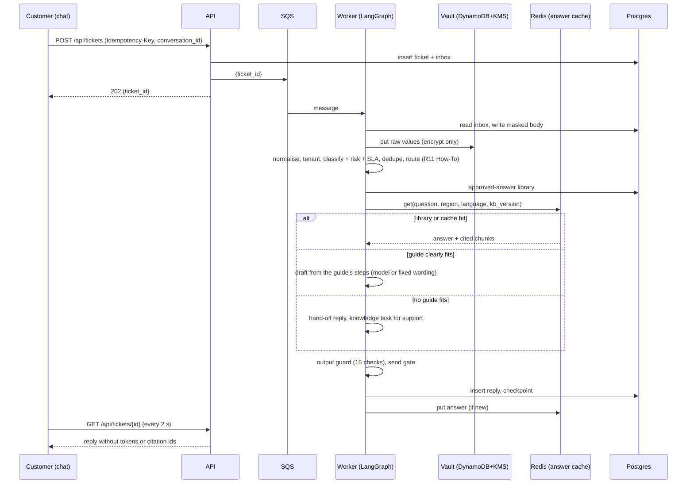

# Low-Level Design (LLD): Payce Support Assist

## 1. Introduction

This document describes how each stage of Payce Support Assist is built: modules, data, interfaces and failure behaviour. Current as of v0.9.12 (23 Nov 2026). The high-level view is in [`architecture.md`](architecture.md); scope and requirements are in [`paynest_PRD.md`](paynest_PRD.md).

## 2. Architectural paradigm and global design choices

An asynchronous, checkpointed agent graph behind a thin API. The API only stores and queues; a worker runs one LangGraph per ticket (thread id = ticket id), saving state in Postgres after every node.

### Key design choices and rationale

| Choice | Rationale |
|--------|-----------|
| Mask before anything else | Tickets carry PAN, Aadhaar, IBAN, Emirates ID; models, logs and checkpoints must only see tokens |
| Code decides, model words | Routing, values and checks are deterministic; the model only phrases a reply from given sources |
| Dated knowledge | Chunks carry `effective_from`, `effective_to`, `superseded_by`; retrieval filters on the question date |
| Review for statutory | Wrong statutory figures land on the employer's filing (DPO); a human approves |
| Cache before RAG for How-To | Repeat questions cost no model call; the KB version is in the key |
| Single region | All AWS resources in ap-southeast-2; India/UAE configs refuse to deploy |
| Read-only integrations | Matches the post-May engineering rule; no write tools for the model |
| What is asked decides autonomy | Information is answered by the agent; money, personal data and legal complaints go to a person whatever the team (`config/risk.yaml`) |
| A guide must fit by its own words | Past-question labels in Q3 are noisy; a guide is used only if its title and text match the question |
| Learn once, reuse | An answer a person writes joins the library and the guide itself; waiting customers get it at once |
| Contract-driven priority | P1-P3 and deadlines from MSA Schedule 3 (`config/sla.yaml`), recorded on every ticket |

## 3. Stage-by-stage design

### Stage 1: Intake (`api/main.py`, `intake/store.py`)
- `POST /api/tickets` (202): validates tenant id and size, writes `tickets` + `ticket_inbox` (raw), sets `conversation_id`, sends `{"ticket_id"}` to SQS.
- Idempotency: unique index on `(tenant_id, idempotency_key)`; a repeat returns the first ticket with 200.
- If the queue send fails, the ticket is deleted and the API returns 503 (no orphan tickets).
- `GET /api/tickets/{id}` returns only customer fields (`CUSTOMER_FIELDS`: id, ref, status, agent_status, route, language, created_at, masked body, conversation, feedback, replies) through `agent.unmask.customer_view` (no tokens, no citation ids). No team, rule, reason or decision record.
- `POST /api/tickets/{id}/feedback` records "Did this solve it?".

### Stage 2: PII gate (`pii/masker.py`, `intake/pipeline.py`, `intake/vault.py`)
- Digits normalised (Arabic-Indic, Devanagari); spans found by format: PAN `[A-Z]{5}\d{4}[A-Z]`, IBAN by country length or mod-97, Emirates ID `784-…`, Aadhaar by checksum or context, phones (IN/UAE), emails, names (cue patterns, Arabic patterns, optional Presidio + spaCy).
- Tokens `<KIND_n>`; values to `DynamoKmsVault.put` (append-only, TTL, encryption context `{ticket_id, token, tenant_id}`).
- Re-scan of the masked text; a hit sets `status = pii_blocked` and the router blocks with a holding reply.
- The inbox row is deleted once masked.

### Stage 3: Agent graph (`agent/graph.py`, `agent/nodes.py`, `agent/state.py`)
Nodes in order: `pii_gate`, `normalise`, `resolve_tenant`, `classify`, `dedupe`, `route`, `draft`, `output_guard`, `send`. Each returns only the fields it changes and is idempotent. `shared/tracing.py` wraps each node (JSON `node_done` event; OpenTelemetry span when configured, one X-Ray trace per ticket with `ticket_id` indexed) and adds the node's time to `state.timings`. `send` saves the decision record (`agent/decision.py`): classification and layers, route and rule, answer tier and sources, guard checks passed and failed, timings, trace id, SLA. Ids, labels and scores only, never text.

### Stage 4: Understanding (`agent/conversation.py`, `agent/injection.py`, `agent/classifier.py`)
- `conversation.kind`: greeting, thanks, vague (<= 3 words, no topic); `is_howto`: how-to phrasing with no problem signal (EN, Hinglish, HI, AR).
- Follow-up: the previous turn in the same conversation becomes `context` when it was a clarifying question or the new message is short.
- Classifier: keyword scores -> similar tickets (character TF-IDF kNN) -> model on disagreement; branches auto (>= 0.5, `classify_auto_at`) / clarify / triage. Tie-breaks: how-to phrasing, run-status questions, statutory figures (always Statutory).
- Language (`loader/normalize.language`): script for Hindi and Arabic; Hinglish by two Hinglish words, at least one of 4+ letters (`kaise`, `karun`, `kahan`, ...).
- Risk (`agent/risk.py`, `config/risk.yaml`): money requests (refund, reversal, payment blocked, bank change, off-cycle, "please approve"), private data (another employee's salary, data export or deletion), legal complaints; the largest amount in the customer's words and normalised (INR/AED/USD, lakh, crore). ID numbers alone never count: they are already masked.
- SLA (`agent/sla.py`, `config/sla.yaml`): priority P1 (pay or filing at risk) / P2 (payroll output error, degraded module) / P3; the customer's higher pick is kept; respond-by, resolve-by, credit if missed (fee x credit %, x1.5 past twice the target). Standard tier: best effort.

### Stage 5: Dedupe and routing (`agent/dedupe.py`, `agent/router.py`, `config/router.yaml`)
- Duplicate: explicit reference, or resubmit marker and similarity >= 0.8, within 72 h.
- Incident: 5 similar tickets in 3 h; later tickets attach by signature. Not for how-to questions or repeated statutory questions (a burst of questions is not an outage).
- Jira: word containment >= 0.5 against open issues.
- Router: rules R01 (injection) ... R99 (default), first match wins; output `{route, rule, reason, queue, reply}`. Risk rules: R06a legal -> Support-Lead; R06b money at or above the second-approver limit (INR 1 lakh / AED 5,000 / USD 1,500) -> Finance-Approvals; R06d money -> Payroll-L2; R06e private data -> Privacy-Desk; R08b pay at risk (P1, after statutory) -> Payroll-L2. `reply` names a fixed reply (money, money_high, private, legal) in four languages; the customer's amount is repeated in their own words.

### Stage 6: Answering (`agent/answer_cache.py`, `agent/retrieval.py`, `agent/tools.py`, `agent/drafter.py`, `agent/templates.py`)
- Question date: ISO date or month named in the text, else the ticket date.
- Retrieval: hard filters (tenant region or ALL; valid on the question date), BM25 + character trigrams, light stemming, Arabic/Hindi glossary expansion.
- Tools: `get_rate(region, topic, as_of)`, `get_run_status(run_id)` (429 -> `rate_limited`), `get_tenant_profile`, `get_incident`.
- How-To path: team How-To, how-to phrasing, or (not a problem report) a guide that clearly fits. Order: approved-answer library (`answer_library.best`) -> answer cache (`answer_cache.get(question, region, language, kb_version)`, key carries `ANSWER_FORMAT` 3) -> guides (`retrieval.howto_articles`).
- `howto_articles`: guides ranked by their OWN title and article text (`own_score`, a separate search) plus 0.6 per past question solved (max 5); each chosen guide brings its steps (`Retriever.articles`, `#approved-` parts first). `nodes.clear_winner`: the top guide has steps, `own_score >= guide_fit` (5.0), and leads the next by 2.5 points or 1.5x. Otherwise: hand-off reply, a person writes the answer (learning loop).
- Problem reports (`conversation.PROBLEM`: "not firing", "returns 401", "not included", "blank", ...) never get a guide.
- Review routes: all chunk kinds and all tools; auto routes: guide titles and run status only.
- Drafter: model JSON `{reply, citations, answerable}` from masked ticket + conversation + sources + facts; the How-To prompt asks for numbered steps with exact menu names and forbids ids, counts, scores and invented links; `answerable: false` or no steps -> hand-off. Without the model: the guide's steps in English or Hinglish (`STEPS_INTRO`), or the guide's link (`url:`, four languages), else a hand-off. `customer_steps` drops sentences with "[email removed]"-style masked contact details.
- Demo guides (`data/demo_guides`, `DEMO_GUIDES=on` in the demo region): imported at worker start for guides with no real article; a real import replaces them.

### Stage 7: Guard and send (`agent/guard.py`, `agent/nodes.py`)
- Checks (15): empty, too long, PII, unknown token, bad citation, ungrounded number, uncited answer, wrong region, superseded source, instruction leak, promise, wrong language, internal detail (KB ids, "solved N", scores, rule ids, masked contact lines), not specific (a How-To answer needs two steps or the guide's own link), unknown link (only a used guide's `url`).
- Send gate (`nodes._unsure`): an agent-written How-To answer goes out alone only when the classifiers agree at >= 0.8 (`answer_auto_at`), the guide is a clear winner (`guide_auto_at` 5.0), or the cache matched >= 0.9; else a person approves it. Library answers (written by people) and run-status replies are exempt.
- Pass + route reply / queue / chat / ask / block / incident / duplicate: `insert_reply` (unique on ticket and version).
- Pass + route review, or any failure: `create_review` with the reason; the reviewer approves (reply inserted), edits or rejects. An approval with no text is refused (400).
- Hand-off (no steps, or a risk rule): the fixed reply is sent, the ticket waits for a person, and support gets a knowledge task (one per guide or question) or a reply task.
- Learning (`store.decide_review` -> `_learn`): an approved How-To answer goes to `howto_answers`, to the guide as `kb_chunks` `<KB>#approved-<task>` (the worker reloads within a minute; re-imports keep it), and to every customer waiting on a similar question (their tasks close).

### Stage 8: Consoles and APIs for people (`api/main.py`, `agent/console.py`)
- Roles by token: `LEAD_TOKEN` (client support head, read only), `REVIEWER_TOKENS` (named reviewers, decide), `ADMIN_TOKEN` (FDE). `GET /api/console/whoami` returns the role.
- `GET /api/console/summary`: outcome buckets (resolved, approved, approval, human, merged, chat), confidence bands vs outcome, answer path, impact vs the Q3 baseline.
- `GET /api/console/tickets`: server-side paging, search, sort, counts per outcome (cap 5,000 rows per window). `GET /api/console/tickets/{id}`: timeline, English translation of masked text on first open (`agent/translate.py`: tokens, citations and numbers must survive), role, open task, AWS region for the trace link. `/compare?date=`: the same statutory question on another date.
- `GET /api/console/engineering` (admin only): per-node p50/p95, slowest tickets with X-Ray links, failures and guard stops, model calls by step and rung.
- `GET/POST /api/review/tasks`, `/api/knowledge` (import Markdown/HTML/text articles with optional `url:`, and an approved-answers CSV; masked before storage).
- Web (`web/src`): one theme (`theme.jsx`), pages Control room, Customer chat (keeps its conversation across reloads), Review, Knowledge.

### Stage 9: Data and storage (`db/migrations/001-012`)
- Postgres (RDS): tickets (with decision record, translation, feedback), events, tenants, SLA terms, rules, kb_chunks (+ `url`, migration 012), knowledge_imports, howto_answers, incidents, review_tasks (kind reply / knowledge, outcome), sent_replies, cost_ledger, eval labels, LangGraph checkpoints.
- DynamoDB: PII vault. S3: raw data room (laptop-only writes), masked eval set. Redis: answer cache.

## 4. Sequence diagram: chat How-To question

## 5. Failure behaviour

| Failure | Behaviour |
|---------|-----------|
| Worker crash mid-graph | Message redelivered; graph resumes at the failed node |
| Message fails 3 times | Moves to the DLQ; alarm `tickets-dlq-not-empty` |
| PII left after masking | Ticket quarantined, holding reply, no model call |
| Model down, no key, or budget spent | Cited fallback or template; never an uncited answer |
| Run-status 429 / timeout | Fact marked `rate_limited` / `unavailable`; no status claimed |
| Cache down | Treated as a miss |
| Guard fails | Draft goes to review with the problems (or the fixed wording, if the model's draft failed and the fixed one passes) |
| No guide fits / no steps | Hand-off reply, a person answers once, the answer is learned |
| Reviewer approves with no text | Refused (400); nothing is sent |
| Knowledge reload fails | The worker keeps the current knowledge and retries in a minute |

## 6. Future scalability considerations

- Per-region deployments (ap-south-1, me-central-1) from the same templates once the DPIA allows.
- ElastiCache Valkey for the answer cache; pgvector embeddings for retrieval when KB articles carry full text.
- Console overview from SQL aggregates instead of rows at production volume; reopen tracking as the agent's accuracy; SLA at-risk view and alerts.
- Model-drafted replies for problem tickets (person approves): the main lever for the 30% workload goal (architecture section 15).
- Event-driven KB refresh when a rule's effective date passes (the KB version changes and the cache empties by design).
