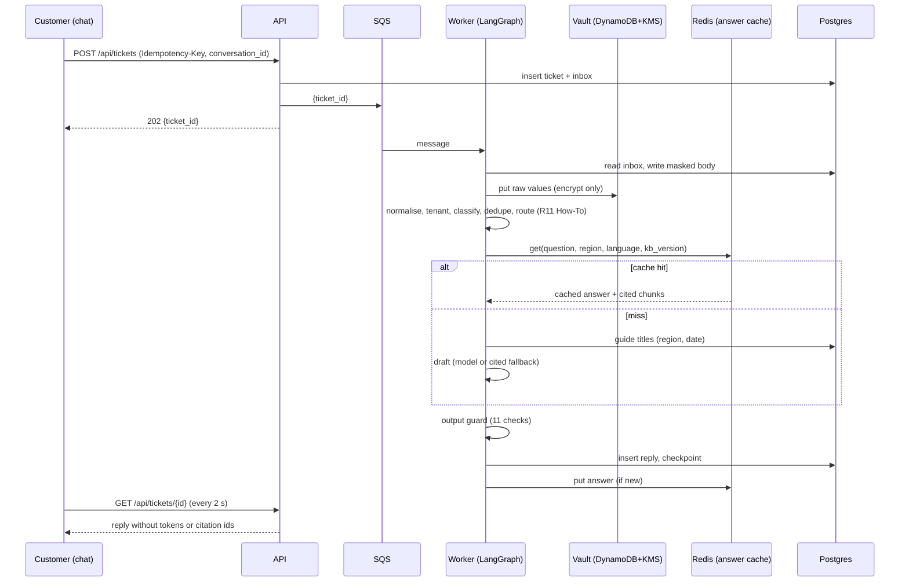

# Low-Level Design (LLD): Payce Support Assist

## 1. Introduction

This document describes how each stage of Payce Support Assist is built: modules, data, interfaces and failure behaviour. The high-level view is in [`architecture.md`](architecture.md); scope and requirements are in [`paynest_PRD.md`](paynest_PRD.md).

## 2. Architectural paradigm and global design choices

An asynchronous, checkpointed agent graph behind a thin API. The API only stores and queues; a worker runs one LangGraph per ticket (thread id = ticket id), saving state in Postgres after every node.

### Key design choices and rationale

| Choice | Rationale |
|--------|-----------|
| Mask before anything else | Tickets carry PAN, Aadhaar, IBAN, Emirates ID; models, logs and checkpoints must only see tokens |
| Code decides, model words | Routing, values and checks are deterministic; the model only phrases a reply from given sources |
| Dated knowledge | Chunks carry `effective_from`, `effective_to`, `superseded_by`; retrieval filters on the question date |
| Review for statutory | Wrong statutory figures land on the employer's filing (DPO); a human approves |
| Cache before RAG for How-To | Repeat questions cost no model call; the KB version is in the key |
| Single region | All AWS resources in ap-southeast-2; India/UAE configs refuse to deploy |
| Read-only integrations | Matches the post-May engineering rule; no write tools for the model |

## 3. Stage-by-stage design

### Stage 1: Intake (`api/main.py`, `intake/store.py`)
- `POST /api/tickets` (202): validates tenant id and size, writes `tickets` + `ticket_inbox` (raw), sets `conversation_id`, sends `{"ticket_id"}` to SQS.
- Idempotency: unique index on `(tenant_id, idempotency_key)`; a repeat returns the first ticket with 200.
- If the queue send fails, the ticket is deleted and the API returns 503 (no orphan tickets).
- `GET /api/tickets/{id}` returns public fields and replies through `agent.unmask.customer_view` (no tokens, no citation ids).

### Stage 2: PII gate (`pii/masker.py`, `intake/pipeline.py`, `intake/vault.py`)
- Digits normalised (Arabic-Indic, Devanagari); spans found by format: PAN `[A-Z]{5}\d{4}[A-Z]`, IBAN by country length or mod-97, Emirates ID `784-…`, Aadhaar by checksum or context, phones (IN/UAE), emails, names (cue patterns, Arabic patterns, optional Presidio + spaCy).
- Tokens `<KIND_n>`; values to `DynamoKmsVault.put` (append-only, TTL, encryption context `{ticket_id, token, tenant_id}`).
- Re-scan of the masked text; a hit sets `status = pii_blocked` and the router blocks with a holding reply.
- The inbox row is deleted once masked.

### Stage 3: Agent graph (`agent/graph.py`, `agent/nodes.py`, `agent/state.py`)
Nodes in order: `pii_gate`, `normalise`, `resolve_tenant`, `classify`, `dedupe`, `route`, `draft`, `output_guard`, `send`. Each returns only the fields it changes and is idempotent. `shared/tracing.py` wraps each node (JSON `node_done` event; OpenTelemetry span when configured).

### Stage 4: Understanding (`agent/conversation.py`, `agent/injection.py`, `agent/classifier.py`)
- `conversation.kind`: greeting, thanks, vague (<= 3 words, no topic); `is_howto`: how-to phrasing with no problem signal (EN, Hinglish, HI, AR).
- Follow-up: the previous turn in the same conversation becomes `context` when it was a clarifying question or the new message is short.
- Classifier: keyword scores -> similar tickets (character TF-IDF kNN) -> model on disagreement; branches auto / clarify / triage.

### Stage 5: Dedupe and routing (`agent/dedupe.py`, `agent/router.py`, `config/router.yaml`)
- Duplicate: explicit reference, or resubmit marker and similarity >= 0.8, within 72 h.
- Incident: 5 similar tickets in 3 h; later tickets attach by signature.
- Jira: word containment >= 0.5 against open issues.
- Router: rules R01 (injection) ... R99 (default), first match wins; output `{route, rule, reason, queue}`.

### Stage 6: Answering (`agent/answer_cache.py`, `agent/retrieval.py`, `agent/tools.py`, `agent/drafter.py`, `agent/templates.py`)
- Question date: ISO date or month named in the text, else the ticket date.
- Retrieval: hard filters (tenant region or ALL; valid on the question date), BM25 + character trigrams, light stemming, Arabic/Hindi glossary expansion.
- Tools: `get_rate(region, topic, as_of)`, `get_run_status(run_id)` (429 -> `rate_limited`), `get_tenant_profile`, `get_incident`.
- How-To: `answer_cache.get(question, region, language, kb_version)`; on a miss, guide titles only; after a guarded send, `put`.
- Review routes: all chunk kinds and all tools; auto routes: guide titles and run status only.
- Drafter: model JSON `{reply, citations, answerable}` from masked ticket + conversation + sources + facts; fallback writes a cited answer from facts or the best guide in the customer's language; otherwise a template.

### Stage 7: Guard and send (`agent/guard.py`, `agent/nodes.py`)
- Checks: empty / too long, PII, unknown token, bad citation, ungrounded number, uncited answer, wrong region, superseded source, instruction leak, promise, wrong language.
- Pass + route reply / queue / chat / ask / block / incident / duplicate: `insert_reply` (unique on ticket and version).
- Pass + route review, or any failure: `create_review` with the reason; the reviewer approves (reply inserted), edits or rejects.

### Stage 8: Data and storage (`db/migrations/001-006`)
- Postgres (RDS): tickets, events, tenants, rules, kb_chunks, incidents, review_tasks, sent_replies, cost_ledger, eval labels, LangGraph checkpoints.
- DynamoDB: PII vault. S3: raw data room (laptop-only writes), masked eval set. Redis: answer cache.

## 4. Sequence diagram: chat How-To question

## 5. Failure behaviour

| Failure | Behaviour |
|---------|-----------|
| Worker crash mid-graph | Message redelivered; graph resumes at the failed node |
| Message fails 3 times | Moves to the DLQ; alarm `tickets-dlq-not-empty` |
| PII left after masking | Ticket quarantined, holding reply, no model call |
| Model down, no key, or budget spent | Cited fallback or template; never an uncited answer |
| Run-status 429 / timeout | Fact marked `rate_limited` / `unavailable`; no status claimed |
| Cache down | Treated as a miss |
| Guard fails | Draft goes to review with the problems |

## 6. Future scalability considerations

- Per-region deployments (ap-south-1, me-central-1) from the same templates once the DPIA allows.
- ElastiCache Valkey for the answer cache; pgvector embeddings for retrieval when KB articles carry full text.
- Event-driven KB refresh when a rule's effective date passes (the KB version changes and the cache empties by design).
